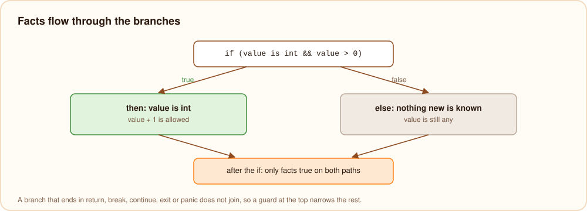

# From text to a checked program

The front end lives in `compiler/src/syntax` (lexer and parser), `compiler/src/project` (modules, projects and
packages) and `compiler/src/check` (type checking). Its result is the IR that every backend starts from.

## Lexer

The lexer (`syntax/lexer.bn`) turns the bytes of a file into tokens. Each token records its byte range and whether a
line break comes before it:

```text
$ burn dump --tokens app.bn
0 3 1 Fun
4 9 0 Ident greet
9 10 0 LParen
...
61 64 1 Var
65 68 0 Ident who
```

The third column is that line-break flag. Burn has no semicolons; the parser uses the flag to decide where a
statement ends, which is why `var x = a` followed by `-1` on the next line is two statements, not `a - 1`.

Number literals are read with their exact digits (hexadecimal, binary, octal, underscores, exponents), so a literal too
large for `int` is still known exactly when the checker later decides its type (it may be a `uint64`). String
literals are split into text and `${...}` parts here, and escapes are decoded.

## Parser

The parser (`syntax/parser.bn`) is hand-written recursive descent: one function per grammar rule, and one function
per precedence level for expressions, from `assignment` down to `postfix` and `primary`. The result is a syntax tree
(`syntax/ast.bn`) where every node carries its byte span, which is what lets every error point at the exact column.

A few things are decided by looking ahead:

- `String name = ...` and `Point p = ...` are declarations because an identifier is followed by another identifier.
- `match` is a keyword only where a match expression can start, so `match` can still be a variable name.
- `new`, `struct`, `static`, `abstract` and `destroy` are recognized by position, not reserved.

After a syntax error, the parser skips to the next statement or declaration and goes on, so one run reports the
errors of all functions, and the checker still checks the parts that parsed.

## Modules and projects

The loader (`project/loader.bn`) starts from the file being run and follows its imports:

- `std/...` modules come from the standard library, whose sources are embedded in the compiler
  (`project/stdlib.bn`), so they need no files on disk and always match the compiler.
- `@/...` imports and bare package names are resolved through the project's `burn.toml`; installed packages live in
  `~/.burn/packages` (or `$BURN_HOME/packages`), at the version `burn.lock` names.
- Other paths are relative to the importing file.

Every file is parsed once, however often it is imported. Import cycles are allowed: the modules are sorted so that a
module's imports are initialized before it whenever possible, and `burn dump --modules` shows the resulting order.

## Type checking

The checker (`check/`) works in passes over all modules together:

1. **Declare.** Every type, function, global and import of every module gets a name in its module's scope, so code
   can use things declared further down or in modules that import it back. Visibility (`pub`/`priv`) and ambiguous
   imports are checked when names are looked up.
2. **Structs.** Fields, constructors, parents and interfaces are filled in, inherited fields are copied in front of
   the child's own, and overrides are compared with the methods they replace.
3. **Conformance.** Every struct is checked against its interfaces and abstract parents; mixins are checked against
   their targets; constructors are generated.
4. **Bodies.** The top level code of each module and then every function body is checked and lowered to the IR.
   Functions are checked in turn, and generic functions only when a version of them is needed.
5. **Initialization order.** A call graph tells which globals each function reads; a top level statement that reads a
   global before its line has run, directly or through calls, is an error.

### Inference

Types flow from values to variables: `var x = 3` makes `x` an `int`. Expected types flow the other way: in
`float f = 1` or `takesFloat(1)` the literal becomes a float, `[]` takes the element type of the variable it is
assigned to, and an object literal `{ ... }` becomes the record type that is expected. A return type that is not
written is the common type of the `return` statements. Parameters always have written types, including the
parameters of lambdas, so a function can be checked on its own.

### Smart casts

While checking a function, the checker carries a list of facts: "the variable in slot 3 is known to be a `string`",
"slot 5 is not null". Conditions produce two sets of facts, one for when they are true and one for when they are
false:



- `x is T`, `x != null` and `x == null` produce facts about `x`;
- `a && b` combines the true-facts of both sides, and checks `b` with the facts of `a` already applied;
- `!c` swaps the two sets;
- `if`, `while` and `match` apply the right set inside each branch;
- after an `if` whose branch ends in `return`, `break`, `continue`, `exit` or `panic`, the other set holds for the rest
  of the block.

Where branches join, only facts that hold on every path survive. An assignment replaces the facts about the variable
with the type of the new value. A loop that assigns a variable clears its facts at the top of the loop, and a call
clears the facts about globals, since the called function may change them.

Facts only change what the checker allows; they cost nothing at runtime. After `v is int`, reading the `any` `v` as
an `int` just takes the number out of its box, without checking its type again.

### Generics

A generic function or type is checked once per set of type arguments it is used with. The first time `largest<int>`
is needed, the checker makes a copy of the function with `T` replaced by `int`, checks it, and gives it its own
function id; later calls with the same arguments reuse it. That is why errors name the version (`largest<bool>`), and
why generic code is as fast as hand-written code.

### Errors and fixes

Every error and warning is a diagnostic with a span, a message, notes, help lines and, where the checker knows the
fix, an edit. The edits are what `burn fix` applies and what editors offer as quick fixes. When a name is not found,
the checker suggests close names by edit distance ("did you mean `length`?") and standard library modules that
define it ("`sqrt` is in the standard library module `std/math`").

## The IR

The checker's output (`check/hir.bn`) is a small typed tree: 33 expression kinds and 6 statement kinds. Every
node has a type id, and everything the source leaves implicit is explicit:

- `int` and `float` arithmetic are different operations, and conversions (`IntToFloat`) are visible;
- string `+`, printing, map access and the like are `Rt` calls to named runtime functions;
- method calls are direct `Call`s when the target is known, `CallIface` with a dispatch slot when it depends on the
  object, and `CallIndirect` for function values;
- structs, records, enum variants, closures and their captured variables are all `NewStruct` with numbered fields;
- `match`, `?.`, `??`, smart casts and string templates are already lowered to conditions, temporaries and calls.

```text
$ burn dump --checked app.bn
func 1 greet params=1 ret=6 async=false
  return
    Rt StrConcat : 6
      Str 1 : 6
      Local 0 : 6
```

The ownership pass, the bvm code generator, both native code generators and the JavaScript generator all start from
this IR, which is why every backend behaves the same.
