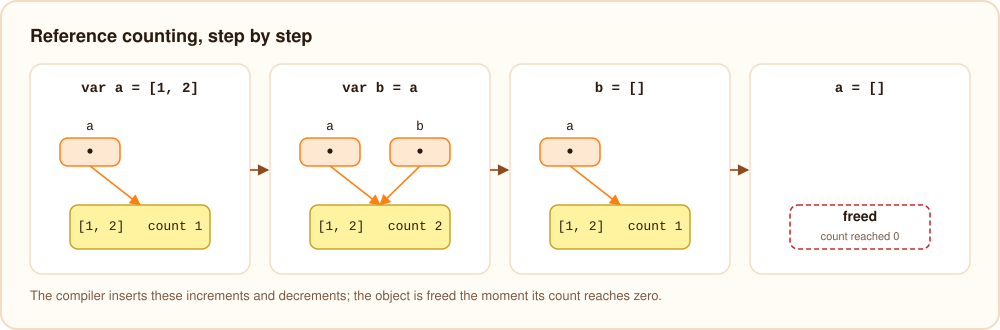
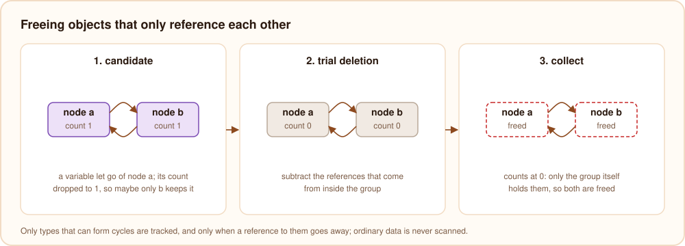

# Memory management

Burn frees memory with reference counting that the compiler inserts, plus a cycle collector for objects that point
at each other. There is no tracing garbage collector and no pause that scans the whole heap. This page shows how that
works; [memory](../language/memory.mdx) describes what it means for programs.

## Which values are counted

Strings, arrays, maps, records, struct objects, enum values with data, closures, futures, boxes for `any` and
nullable numbers are heap objects with a reference count in their header ([values in memory](./values.mdx)).
Numbers, bools, plain enums and `null` are not objects and are never counted.

## The ownership pass

After type checking, `compiler/src/lower/own.bn` walks every function and decides, for every value, who owns it:

- **Owners.** A local variable, a global, a field, an array element and a map entry each own the object they hold.
  So does a temporary: the result of a call, of `"a" + b`, or of `[1, 2]`.
- **Borrowing.** A parameter is borrowed: the caller keeps owning the argument for the duration of the call, so
  passing a value costs nothing.
- **Retain** is inserted where a borrowed value becomes owned: stored in a variable, field, array or map, captured by a
  lambda, or returned.
- **Release** is inserted where an owner lets go: a variable gets a new value or goes out of scope, a field or element
  is overwritten, a temporary has been used, the function returns.
- **Moves.** Returning a local variable hands its value to the caller instead of retaining and releasing it.

`burn dump --owned` shows the result. For

```burn
fun label(n: int): string {
    var s = "item " + n
    return s
}
```

the pass produces (shortened):

```text
SetLocal 1                       s = "item " + (temp 3 = toString(n))
  Rt StrConcat
    Str "item "
    SetLocal 3
      Rt ToStr (Local 0)
Release (Local 2)                the old value of s
Release (Local 3)                the temporary string from toString
SetLocal 4 (Local 1)             move s into the result ...
SetLocal 1 (Null)                ... and forget it in s
return Local 4
```

A few rules keep this safe without extra cost:

- Temporaries are released at the end of the statement that created them, so `print(a + b)` frees the joined
  string right after printing.
- An argument read from a field or a global is retained for the duration of the call, because the called function
  could overwrite that field or global and free the value while it is still using it. Arguments from local variables
  need no such protection.
- String literals are static and their counts are never touched.

## Retain and release at runtime

`retain` adds one to the count. `release` subtracts one, and when the count reaches zero frees the object after
releasing everything it holds. Freeing is a loop over a work list, not recursion, so releasing a linked list of a
million nodes does not overflow the stack.



In native executables both are inlined into the generated code. A release is a handful of instructions:

```text
test rax, rax                  ; null?
jz   done
test byte ptr [rax + 2], 1     ; a static string?
jnz  done
cmp  byte ptr [rip + burn_rc_mt], 0
jne  slow                      ; async tasks running: use atomic operations
dec  dword ptr [rax + 12]      ; count - 1
jz   free                      ; reached zero: free it
test byte ptr [rax + 2], 4     ; could it be part of a cycle?
jnz  maybe_cycle
done:
```

## Cycles

Reference counting alone cannot free objects that only reference each other: each keeps the other's count above
zero. Burn finds them with trial deletion, the algorithm by Bacon and Rajan:



1. **Which types can form cycles** is computed once from the type table, when the program starts. Following the
   types of a type's fields and elements, if you can get back to the same type, or reach `any`, an interface or a
   function value (which could hold anything), objects of that type can be part of a cycle: a struct with a
   `Node? next` field, an `[any]`, a list of shapes behind an interface. A string, an `[int]`, a map of strings or a
   record of numbers cannot. Only objects of the first kind are ever looked at, and they get a flag in their header
   when they are created.
2. **Candidates.** When a release leaves such an object with a count above zero, it might now be kept alive only by a
   cycle. It is colored purple and remembered in a buffer of possible roots.
3. **Collection.** Now and then the collector takes the buffered candidates and, for each, subtracts the references
   that come from inside the graph reachable from it (marking it gray). Objects whose count drops to zero are only
   referenced from inside the group (white); everything else, and everything reachable from it, is restored (black).
   The white objects are garbage, and are freed together.

A collection runs at a safe point on the main thread: when about 32 MB have been allocated since the last one
(`BURN_GC_THRESHOLD` changes this, in bytes), or when 20,000 candidates are buffered. Its cost depends on the number
of candidates and the objects they reach, not on the size of the heap. `BURN_GC_STATS=1` prints a line for each
collection.

## Async tasks and threads

[Async tasks](../language/async.mdx) run on their own threads and share objects with the main program. While any task
is running, the runtime switches the counting to atomic operations (the `burn_rc_mt` flag above), so two threads can
retain and release the same object safely. In that mode, an object whose count reaches zero is not freed on the spot
but handed to the main thread, which frees it at its next safe point, and cycle collection waits until the tasks are
done. When the last task finishes, counting goes back to plain, faster instructions.

Each task gets its own share of the values passed to it, so the caller can let go of them while the task still runs.

## The heap limit

The runtime counts the bytes of every live object. When the total exceeds the limit, the program stops with
`out of memory: the program keeps ... MB of data alive, more than its limit of ... MB` instead of making the computer
swap. The limit is three quarters of the physical memory by default; `BURN_MAX_HEAP_MB` sets it in megabytes, and `0`
removes it.

## Checking it

The test suite runs the test programs with `BURN_RC_CHECK=1`, which makes every retain and release verify that the
object is still alive and report "internal error: release of a freed object" otherwise, and with a tiny
`BURN_GC_THRESHOLD`, which makes the cycle collector run constantly. Neither setting changes a program's output; both
only make mistakes in the ownership pass visible at once.
