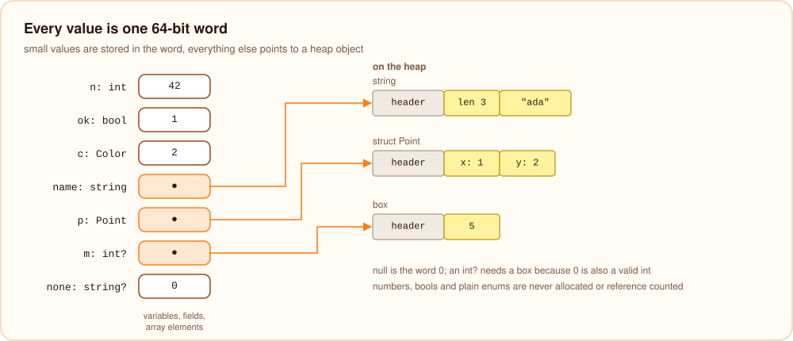
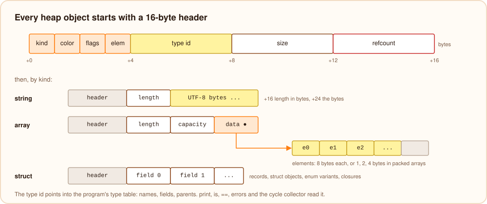
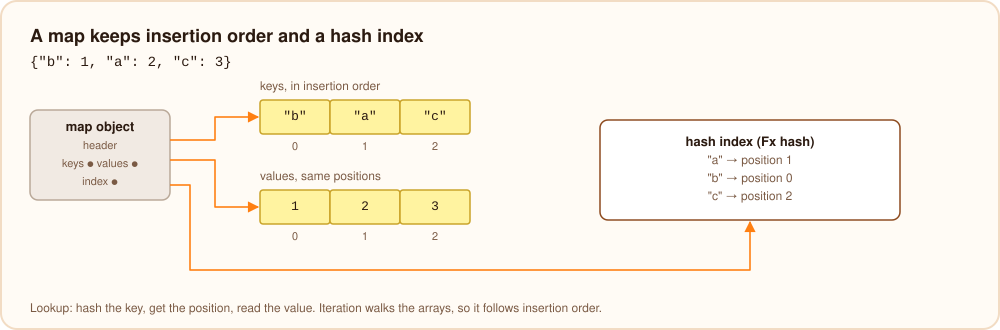
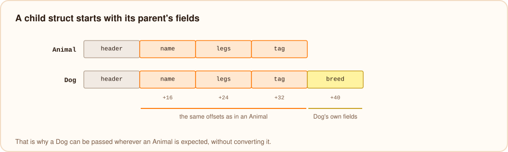
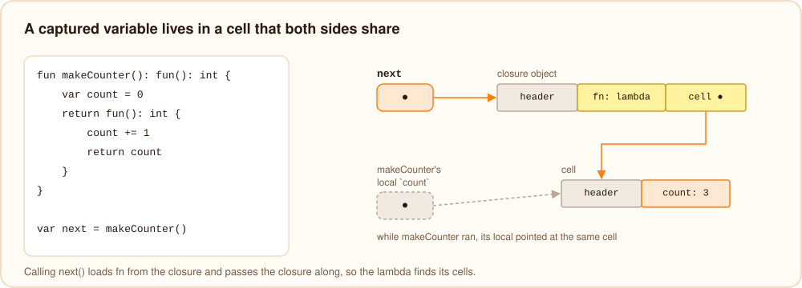
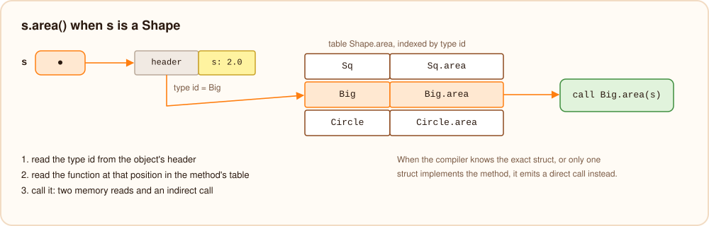

# Values in memory

Burn compiles every value to one 64-bit word. Small values are stored in the word itself; everything else is a pointer
to an object on the heap. The layout is the same on bvm and in native executables, which is what lets native
programs embed and call bytecode libraries. (The JavaScript backend maps values to JavaScript values instead.)



## Values stored in the word

| Type | The word holds |
| --- | --- |
| `int`, `int64` | the number |
| `int8` ... `uint32`, `uint64` | the number, sign- or zero-extended to 64 bits |
| `float` | the IEEE 754 bits of the double |
| `float32` | a double rounded to single precision |
| `bool` | `0` or `1` |
| a plain enum | the variant's number |
| `null` | `0` |
| everything else | a pointer to a heap object |

These values cost nothing to copy and are never reference counted.

## Heap objects

Every heap object starts with a 16-byte header:

| Offset | Size | Field |
| --- | --- | --- |
| 0 | 1 | kind: string, array, struct, box, map, future, or destroyed |
| 1 | 1 | color, used by the cycle collector |
| 2 | 1 | flags: static (never freed), ASCII-only string, may be part of a cycle, buffered, freed by another thread |
| 3 | 1 | element kind of a packed array |
| 4 | 4 | type id |
| 8 | 4 | size in bytes |
| 12 | 4 | reference count |



Objects are allocated 16-byte aligned and zeroed. The type id is an index into the program's type table, which knows
every type's name, fields and parents; it is what `print`, `is`, `as`, `==`, error messages and the cycle collector
use to understand an object.

## Strings

A string object holds its length in bytes at +16 and the UTF-8 bytes from +24. String literals are created once (by
bvm when it loads the module; in native executables they are ready-made objects in the read-only data) and marked
static, so using them never touches a reference count.

The header flag for ASCII-only text makes `len(s)` and `s[i]` constant-time for such strings; for text with other
characters they walk the UTF-8 bytes. `s += piece` checks the reference count first: when it is 1, nobody else can
see the string, so the bytes are appended in place (growing the object like a vector) instead of copying.

## Arrays

An array object holds its length at +16, its capacity at +24 and a pointer to a separate element buffer at +32.
Elements are 8-byte words, except for arrays of `int8`, `uint8`, `int16`, `uint16`, `int32`, `uint32` and `float32`,
which store 1, 2 or 4 bytes per element (the element kind in the header says which). `push` doubles the capacity when
it runs out, so appending is amortized constant time. Indexing checks the bounds against the length.

## Maps

A map keeps its keys and values in two arrays in insertion order, plus a hash index from key to position (an Fx hash,
a fast multiplicative hash). That is why iteration and `keys(m)` follow insertion order. Lookup and insertion are
constant time on average; `remove` closes the gap, so it takes time proportional to the number of entries after
the removed one.



## Records, structs and enum variants

Records (`def type`), struct objects and enum variants with data are all struct objects: the header, then one word
per field from +16, in declaration order. A struct that extends another starts with the parent's fields, so a child
object can be passed wherever the parent is expected and the parent's code finds its fields at the same offsets.



```text
def struct Dog(name: string, breed: string) :: Animal(name)
  +16 name     (from Animal)
  +24 legs     (from Animal)
  +32 tag      (from Animal)
  +40 breed
```

An enum with data is an interface in the type table, and each variant is a record type that implements it:

```text
$ burn dump --bvm shapes.bn
type Shape = interface
type Shape.Circle = record { radius: float } implements Shape
type Shape.Dot = record {} implements Shape
```

So `match` on a variant is a type id check, and reading a variant's field is an ordinary field read.

## Nullable values and `any`

For types whose values are pointers, `null` is simply `0`, so `string?` or `Point?` costs nothing extra. For types
stored in the word, `0` is a valid value, so `int?`, `bool?` or `float?` hold a pointer to a box (an object with the
value at +16) or `0` for `null`.

`any` works the same way: an object is stored as itself (its type id is in its header), and a number, bool or enum is
put in a box whose header carries the value's type id. `is`, `as` and `match` read the type id; after a check, reading
the value is a plain field read.

## Closures

A function value is a struct object whose first field is the function's address. A lambda that captures variables
has one more field per captured variable, and each captured variable lives in a small object of its own, a cell:

```burn
fun makeCounter(): fun(): int {
    var count = 0
    return fun(): int {
        count += 1
        return count
    }
}
```

```text
$ burn dump --checked counter.bn
func 1 makeCounter
  SetLocal 0 : <cell>
    NewStruct <cell>
      Int 0
  return
    NewStruct <closure>
      FuncRef 2
      Local 0
```

Because `makeCounter` and the lambda share the cell, a change through either is seen by both, and the cell lives as
long as one of them holds it. Calling a function value loads the address from field 0 and passes the closure itself
as a hidden first argument, which is how the lambda finds its cells. Variables that are never captured stay ordinary
locals.



## Method calls and dispatch

How a call finds its code depends on what the compiler knows:

- **Direct calls.** A call to a function, a static method, a struct method on a value whose struct is known exactly,
  or a function added to one object is a direct call. Most calls are direct.
- **Dispatch tables.** A call through an interface, or through a parent struct whose method is overridden, goes
  through a table. For each such method the program has one table, indexed by type id, that lists the function to run
  for every struct:

  ```text
  table Shape.area 1 { Sq: Sq.area, Big: Big.area }
  ```

  The call reads the object's type id from its header and calls the function at that position in the table: two
  memory reads and an indirect call.
- **Devirtualization.** When only one struct implements a method, or [smart casts](../language/smart-casts.mdx) know
  the exact struct, the compiler emits a direct call instead.
- **Function values.** Calling a lambda or function reference loads the address from the closure and calls it.



## Type checks

`x is Dog` compares the type id in the object's header with `Dog`; if they differ, it looks `Dog` up in the list of
parents and interfaces the type table keeps for the object's type, which already includes the parents of parents, so
the check never walks a chain of types. `x as Dog` does the same
check and fails with an error naming the actual type.

## Destroyed objects

`destroy x()` runs the struct's `destroy` function, releases the object's fields, and changes the object's kind to
"destroyed" without freeing it while references to it remain. Every field access on an object checks its kind only in
programs that use `destroy`, which is how a use after `destroy` becomes the error "this object was destroyed" instead
of a crash.
