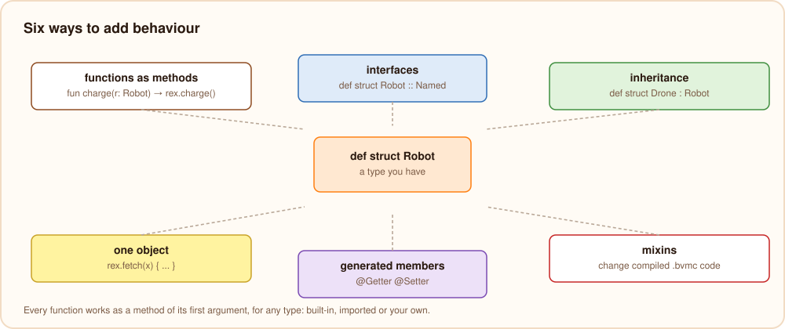

# Extending types and objects

Burn has several ways to add behaviour to something that already exists. They differ in what they extend (every value
of a type, a family of types, or one object) and in when they apply (while compiling, or to compiled code):



| Way | Extends | Use it to |
| --- | --- | --- |
| [Method syntax](#functions-as-methods) | every value of any type, including built-in and imported ones | add operations to types you did not write |
| [Interfaces](#interfaces) | any struct that says it implements them | write code that works with many structs |
| [Inheritance](#inheritance) | one struct, by making a child struct | reuse fields and methods, and override some |
| [Functions on one object](#functions-on-one-object) | a single object | give one object an extra capability |
| [Generated members](#generated-members) | a struct, through annotations | get getters and setters without writing them |
| [Mixins](#mixins) | compiled bytecode | change a library or app you only have as `.bvmc`/`.bar` |

## Functions as methods

Every function can be called as a method of its first argument, so adding a "method" to a type is writing a function
that takes it first. This works for every type: numbers, strings, arrays, maps, enums, records, structs, and types
from other modules or packages.

```burn
fun shout(s: string): string {
    return upper(s) + "!"
}

fun isEven(n: int): bool {
    return n % 2 == 0
}

fun total(prices: [float]): float {
    var sum = 0.0
    for p in prices {
        sum += p
    }
    return sum
}

def enum Light { Red, Green }

fun flip(l: Light): Light {
    return match l {
        Red => Light.Green
        Green => Light.Red
    }
}

print("hey".shout(), 10.isEven(), [1.5, 2.5].total(), Light.Red.flip())
```

- `x.f(a, b)` means `f(x, a, b)`. Calls chain: `text.trim().shout()`.
- A function from an imported module works the same way, so a module can add operations to types defined elsewhere:
  `import "std/strings"` lets every string call `.padLeft(...)`.
- When the type has a method with that name (declared in its `def struct`, inherited, or added to one object), the
  method wins. A free function cannot replace a struct's method.
- These functions only see what is public. They cannot read `priv` fields of a struct.
- Generic functions work as methods too: `fun firstOf<T>(xs: [T]): T` gives every array `.firstOf()`.

This is the usual way to give enums, records and built-in types more operations, since only structs have method
bodies.

## Interfaces

An interface names a set of methods. A struct that lists it after `::` must implement all of them, and can then be
used wherever the interface is expected:

```burn
def interface Shape {
    fun area(): float
    fun name(): string
}

def struct Square(side: float) :: Shape {
    fun area(): float {
        return side * side
    }

    fun name(): string {
        return "square"
    }
}

def struct Circle(r: float) :: Shape {
    fun area(): float {
        return 3.14159 * r * r
    }

    fun name(): string {
        return "circle"
    }
}

fun describe(s: Shape): string {
    return "${s.name()} of ${s.area()}"
}

[Shape] shapes = [new Square(2.0), new Circle(1.0)]
for s in shapes {
    print(describe(s))
}
```

- Interfaces only declare methods: no fields, no bodies, no type parameters, and an interface cannot extend another.
  Shared code goes into a function that takes the interface, or into an
  [abstract struct](./structs-and-interfaces.mdx#abstract-structs).
- A struct can implement any number of interfaces: `def struct Doc(text: string) :: Printable, Saveable { ... }`.
  Only structs implement interfaces; records and enums do not.
- `s is Square` and `match s { is Square sq => ... }` get the struct back from an interface value.

## Inheritance

A struct can extend one other struct and inherit its fields, methods, interfaces and static members. A regular
struct is extended with `:`, an abstract one with `::`:

```burn
def abstract struct Animal(name: string) {
    abstract fun sound(): string

    fun describe(): string {
        return "${name} says ${sound()}"
    }
}

def struct Dog(name: string) :: Animal(name) {
    fun sound(): string {
        return "woof"
    }
}

def struct Puppy(name: string) : Dog(name) {
    fun sound(): string {
        return "yip"
    }

    fun describe(): string {
        return Dog.describe(self) + " (a puppy)"
    }
}

Animal a = new Puppy("Bit")
print(a.describe(), a is Dog)
```

- A child can override any method, with exactly the same signature. Calls run the method of the object's real struct,
  also through a parent-typed variable.
- `Parent.method(self, ...)` calls the parent's version from an override; there is no `super`.
- The child can use the parent's `priv` fields and methods.
- Static members are shared: `Dog.count` and `Puppy.count` are the same variable.

The full rules are in [structs and interfaces](./structs-and-interfaces.mdx#extending-structs).

## Functions on one object

A function can be added to a single object, without changing its struct:

```burn
def struct Robot(name: string) {
    int battery = 100
}

Robot rex = new Robot("Rex")

rex.fetch(thing: string): string {
    battery -= 10
    return "${name} fetches the ${thing} (${battery}%)"
}

print(rex.fetch("ball"))
```

The function sees the object's fields and methods through `self`, like a method. The compiler tracks it per variable,
like a smart cast: other objects of the struct do not have it, and it is forgotten when the variable gets another
object. See [functions on a single object](./structs-and-interfaces.mdx#functions-on-a-single-object) for the rules.

## Generated members

The `@Getter` and `@Setter` annotations write accessor methods for a struct's fields:

```burn
@Getter
@Setter
def struct Account(owner: string, balance: int) {
    bool frozen = false
}

var acc = new Account("Ada", 10)
acc.setBalance(acc.getBalance() + 5)
print(acc.getOwner(), acc.getBalance(), acc.isFrozen())
```

A method you write with the same name takes precedence over the generated one. Your own annotations
(`def annotation`) can be read at runtime with `annotationsOf`, which lets libraries attach behaviour to types by
annotation. See [annotations](./annotations.mdx).

## Mixins

Mixins change code that is already compiled to bvm bytecode: a program can import a library or app as `.bvmc` and
run a function at the start of one of its functions, change what it returns, replace its body, or replace a call
inside it.

```burn
fun greet(name: string) {
    print("hello " + name)
}

@Inject(target: "greet", at: "head")
fun logGreet(name: string) {
    print("about to greet " + name)
}

greet("ada")
```

prints `about to greet ada`, then `hello ada`. Here `greet` is in the same file; usually it comes from an imported
`.bvmc` library.

The bvm linker applies mixins when the program is linked, so they work on code you do not have the source for. They
need the bvm target (they are rejected for native executables and JavaScript). See [mixins](../bvm/mixins.mdx).

## Which one to use

- To add an operation to a type, write a function and call it with method syntax.
- To let different structs be used the same way, declare an interface.
- To build a variant of a struct that shares most of its code, extend it.
- To give one object extra behaviour for a while, add a function to that object.
- To change compiled code you cannot rebuild, use a mixin.
