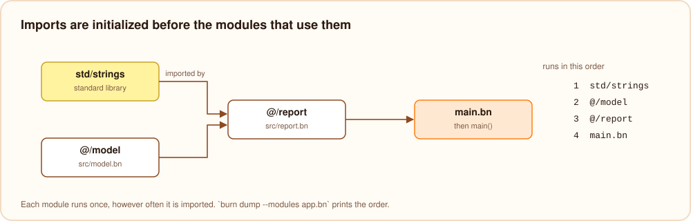

# Modules and visibility

## Importing

```burn
import "std/date"
import "@/net/http"
import "github.com/you/colors/palette"
import (
    "json"
    "../shared/geometry.bn"
)
```

| Import | Loads |
| --- | --- |
| `"date"`, `"std/date"` | a module of the standard library |
| `"@/net/http"` | `src/net/http.bn` of the project the file is in, from anywhere in the project (like Rust's `crate::`) |
| `"github.com/you/colors"` | the main file of an installed package, see [projects and packages](../tooling/packages.mdx) |
| `"github.com/you/colors/palette"` | `src/palette.bn` of that package (like a fully qualified Java import) |
| `"utils"`, `"../shared/geometry.bn"` | a file relative to the importing file, then to the current directory |

- Folders inside `src/` are packages: `src/net/http.bn` is the module `net/http`. A folder can also be imported as
  a whole when it has a `mod.bn`: `import "@/net"` loads `src/net/mod.bn`.
- `.bn` is optional everywhere.
- Each module is loaded once, and its top level statements run once, before the importing module.

## `pub` and `priv`

Everything declared at the top level of a module is visible to modules that import it, unless it is marked
`priv`. `pub` makes the intent explicit.

```burn
import "std/math"

pub def type Vec2 {
    float x
    float y
}

pub fun length(v: Vec2): float {
    return sqrt(square(v.x) + square(v.y))
}

priv fun square(x: float): float {
    return x * x
}

priv var created = 0
```

Using a private name from another module is a compile error (`` `square` is private to its module ``).
Imports are not re-exported: a module sees its own names and the public names of the modules it imports directly.
If two imports define the same name, using it is reported as ambiguous.

## Names from several modules

Importing a module brings its public names into the importing file, unqualified: after `import "std/strings"`,
`padLeft` is just `padLeft`. There is no `import ... as` and no `module.name` syntax.

- A name declared in the file itself takes precedence over an imported one with the same name.
- When two imported modules both define a name and the file does not, using it is an error that names both modules:
  "`area` is ambiguous: it is defined in geo.bn and shapes.bn". Rename one of them, or declare a function in your own
  file that calls the one you mean.
- Only names are imported, never statements: importing a module twice, or from several files, loads and runs it once.

## Initialization order

Each module's top level statements run once, before the statements of the modules that import it, and the program's
own file runs last (followed by `main`, if there is one). Imports can form cycles, for example two modules that call
each other's functions; Burn then picks an order that runs each module after as many of its imports as possible, and
`burn dump --modules app.bn` shows it. Globals that one module reads from another during initialization should
therefore not depend on a cycle.



## The standard library

| Module | Contents |
| --- | --- |
| `std/math` | `PI`, `E`, `TAU`, the `Math` helpers and the math functions ([page](../stdlib/math.mdx)) |
| `std/strings` | padding, lines, words and character tests ([page](../stdlib/strings.mdx)) |
| `std/list` | `map`, `filter`, `reduce`, `sortBy`, `range` and other array helpers ([page](../stdlib/collections.mdx)) |
| `std/collections` | sets, stacks, queues and counters ([page](../stdlib/collections.mdx)) |
| `std/fs`, `std/path` | files, folders and paths ([page](../stdlib/fs.mdx)) |
| `std/process` | arguments, environment, running programs, `exit` and `panic` ([page](../stdlib/process.mdx)) |
| `std/json` | `JSON.parse`, `JSON.stringify` ([page](../stdlib/json.mdx)) |
| `std/http` | HTTP requests ([page](../stdlib/http.mdx)) |
| `std/date`, `std/time` | dates, times, `sleep` ([date](../stdlib/date.mdx), [time](../stdlib/time.mdx)) |
| `std/random` | random numbers ([page](../stdlib/collections.mdx)) |
| `std/testing` | `test`, `expectEqual` and friends ([page](../tooling/testing.mdx)) |

The `std/` prefix is optional (`import "math"`). When a program uses a standard library function without importing its
module, the error says which module to import, and `burn fix` adds the import.
