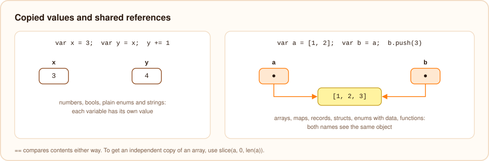

# Types and definitions

## Built-in types

| Type | Example |
| --- | --- |
| `int` | `42`, `0x1F`, `1_000_000` |
| `float` | `3.14`, `2.5e-3` |
| `bool` | `true`, `false` |
| `string` | `"text"` |
| `[T]` | `[1, 2, 3]` |
| `{K: V}` | `{"ada": 36}` |
| `T?` | `null` or a `T` |
| `any` | any value, see [smart casts](./smart-casts.mdx) |
| `fun(A, B): R` | a function value |
| `Future<T>` | the result of an `async fun` |

## Sized numbers

`int` and `float` are 64 bits wide and are the right choice most of the time. When the size of a number matters,
for example for bytes, pixels, file formats, hashes or large arrays, Burn has sized types:

| Type | Values | Other names |
| --- | --- | --- |
| `int8`, `int16`, `int32` | -128 to 127, -32768 to 32767, -2147483648 to 2147483647 | `Int8`, `Int16`, `Int32` |
| `uint8`, `uint16`, `uint32` | 0 to 255, 0 to 65535, 0 to 4294967295 | `byte`, `UInt8`, `UInt16`, `UInt32` |
| `uint64` | 0 to 18446744073709551615 | `UInt64` |
| `float32` | a 32-bit float, about 7 significant digits | `Float32` |
| `int64`, `float64` | the same types as `int` and `float` | `Int64`, `Float64` |

```burn
uint8 red = 200
int16 sample = -1200
uint64 hash = 14695981039346656037
float32 ratio = 0.5
[uint8] pixels = [255, 128, 0]
```

Number literals take the type they are used as, and a literal that does not fit is an error:

```burn
uint8 b = 256   // error: `256` does not fit in uint8
```

### Arithmetic

Math on a sized type gives the same type, and a result that does not fit stops the program with an error, just like
`int` overflow:

```burn
uint8 a = 200
print(a + 55)    // 255
print(a + 100)   // runtime error: integer overflow: 300 does not fit in uint8
```

When two different integer types meet, the smaller one is widened automatically if that loses nothing: `uint8 + int`
is an `int`, `uint8 + int8` is an `int16`. `uint64` mixed with a signed type, and every narrowing, need `as`:

```burn
int total = 1000
uint8 small = total as uint8   // checked: fails at runtime if total does not fit
float32 f = 3.75
int8 whole = f as int8         // 3, the fraction is dropped
```

For hashes and checksums, where wrapping around is the point, use `wrappingAdd`, `wrappingSub` and `wrappingMul`:

```burn
fun fnv(text: string): uint64 {
    uint64 h = 14695981039346656037
    for b in text.bytes() {
        h = (h ^ b).wrappingMul(1099511628211)
    }
    return h
}
```

Bit operators work on every integer type. `>>` on an unsigned type shifts in zeros, `~` flips only the bits of the
type, and `<<` drops the bits that do not fit.

### Packed arrays

Arrays of `int8`, `uint8`, `int16`, `uint16`, `int32`, `uint32` and `float32` store each element in 1, 2 or 4 bytes
instead of 8. A `[uint8]` of a million elements takes 1 MB instead of 8 MB, and loops over packed arrays touch less
memory, so they run faster. `text.bytes()` turns a string into its UTF-8 bytes and `fromBytes(bytes)` turns them back.

## Everything else is defined with `def`

Every user defined type uses the same shape: `def <kind> Name { ... }`.

### `def type`

A record of named fields. Fields can be written as `name: Type` or `Type name` and may have defaults.

```burn
def type Person {
    name: string,
    age: int,
    active: bool
}

def type Config {
    string host = "localhost"
    int port = 8080
    [string] tags
}

var c = Config { port: 9000 }
var p = Person { name: "Ada", age: 36, active: true }
var q = Person("Grace", 45, true)
```

Records compare by value with `==` and print nicely with `print`.

A `def type` can also name another type:

```burn
def type UserId = int
def type Matrix = [[float]]
```

### Anonymous records

An object literal without a type name gets its type from the context. If nothing is expected, Burn looks for a
single `def type` with exactly those fields, and otherwise creates an anonymous record type:

```burn
fun origin(): Person {
    return { name: "nobody", age: 0, active: false }
}

var point = { x: 1.5, y: 2 }
print(point.x + point.y)
```

### `def enum`

```burn
def enum Color { Red, Green, Blue }

def enum Shape {
    Circle(radius: float),
    Rect(w: float, h: float)
}

print(Color.Green, Shape.Rect(2.0, 3.0))
```

A plain enum is a list of names; variants can also carry data, which [`match`](./match.mdx) takes apart. See
[enums](./enums.mdx).

### `def struct` and `def interface`

Structs hold fields and methods and are created with `new`:

```burn
def struct Point(x: int, y: int) {
    fun sum(): int {
        return x + y
    }
}

var p = new Point(1, 2)
```

See [structs and interfaces](./structs-and-interfaces.mdx) for constructors, inheritance, abstract and static
structs, and destroying objects.

## Arrays

```burn
var numbers = [5, 3, 8]
numbers.push(1)
sort(numbers)
print(numbers[0], numbers.length, contains(numbers, 8))
[[int]] grid = [[1, 2], [3, 4]]
grid[1][0] = 30
```

## Maps

```burn
var ages = {"ada": 36, "alan": 41}
ages["grace"] = 45
print(ages["ada"], has(ages, "bob"), keys(ages))
{string: [int]} scores = {}
```

Reading `map[key]` gives a nullable value, `int?` for the map above, because the key may be missing. Give it a
fallback with `ages["bob"] ?? 0`, check it with `!= null`, or assert with `ages["ada"]!!`.
`get(map, key, default)` still works as well.

## Generics

Functions, records and structs can take type parameters: `fun first<T>(items: [T]): T?`, `def type Pair<A, B>`,
`def struct Stack<T>()`. See [generics](./generics.mdx).

## Values and references

Numbers, `bool`, plain enums and strings behave as values: assigning one to another variable or passing it to a
function gives an independent copy, and nothing done through one name changes the other. (Strings are never changed
in place where another name could see it, so sharing them is safe.)

Arrays, maps, records, struct objects, enum values with data and functions are references: assigning or passing one
shares the same object, and a change through one name is visible through every other.



```burn
def type Point {
    x: int
    y: int
}

var a = [1, 2]
var b = a
b.push(3)

var p = Point { x: 1, y: 2 }
var q = p
q.x = 10

print(a, p.x)
```

prints `[1, 2, 3] 10`. To get an independent copy, build a new value: `slice(a, 0, len(a))` copies an array, and
`Point { x: p.x, y: p.y }` a record.

Being references does not change what `==` means: it compares contents, not identity (see
[equality](./operators.mdx#equality)). The compiler frees a referenced object when its last reference goes away;
see [memory](./memory.mdx).
